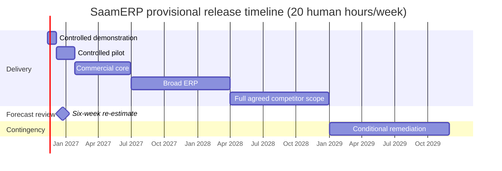

# Release roadmap

Baseline: 2026-11-11. Development: 20 human hours/week including learning, reviews, defects, support and operations. AI assistance is not a second independently accountable engineer.

| Phase | Start | Target | Exit condition |
|---|---|---|---|
| Demonstration | 2026-11-11 | 2026-12-05 | Selected complete workflows on synthetic data; limitations disclosed |
| Controlled pilot | 2026-12-06 | 2027-01-25 | Agreed pilot workflows validated; finance/payroll run in parallel until specialist sign-off |
| Commercial core | 2027-01-26 | 2027-06-30 | Reliable sales/procurement/inventory/finance/HR and corresponding mobile workflows |
| Broad ERP | 2027-07-01 | 2028-03-31 | Remaining Dolibarr baseline, operations/configuration, on-premises deployment and migration coverage |
| Full agreed competitor scope | 2028-04-01 | 2028-12-31 | Approved gap register implemented and accepted across required clients |
| Contingency | 2029-01-01 | 2029-11-30 | Complex gaps, quality and operational remediation if required |

Rough gross capacity to 31 Dec 2028 is about 2,230 hours. Reserving 30% for learning, support, defects and operations leaves about 1,560 hours for planned delivery. This is a capacity illustration, not a bottom-up scope estimate; complete competitor parity may exceed it materially.

## First week: 20-hour planning envelope

| Work | Hours |
|---|---:|
| GitHub foundation and permissions | 2 |
| Feature inventory and release acceptance | 6 |
| Module and financial transaction design | 6 |
| Architecture/build spike | 4 |
| Specialist review and plan adjustment | 2 |

Detailed first-week estimates are in the backlog. Dependencies can cross days; dates are targets rather than promises. Later epics have phase windows but no invented effort estimates.

## Review cadence

- Weekly: compare accepted work with planned hours; review finance/HR/tax evidence and blockers.
- 2026-12-23: six-week forecast checkpoint. Rebaseline remaining dates based on actual throughput and scope.
- Before every release: permission, accounting, payroll, migration, mobile, recovery and load gates as applicable.
- Dates move when evidence requires it; retain baseline and explain changes in an issue.

## Release gate

No critical unresolved integrity/privacy defects; required workflows and reports accepted; upgrade/rollback and restore rehearsed; known limitations documented; required mobile distribution validated. Full parity is never inferred from module menus or screenshots.
